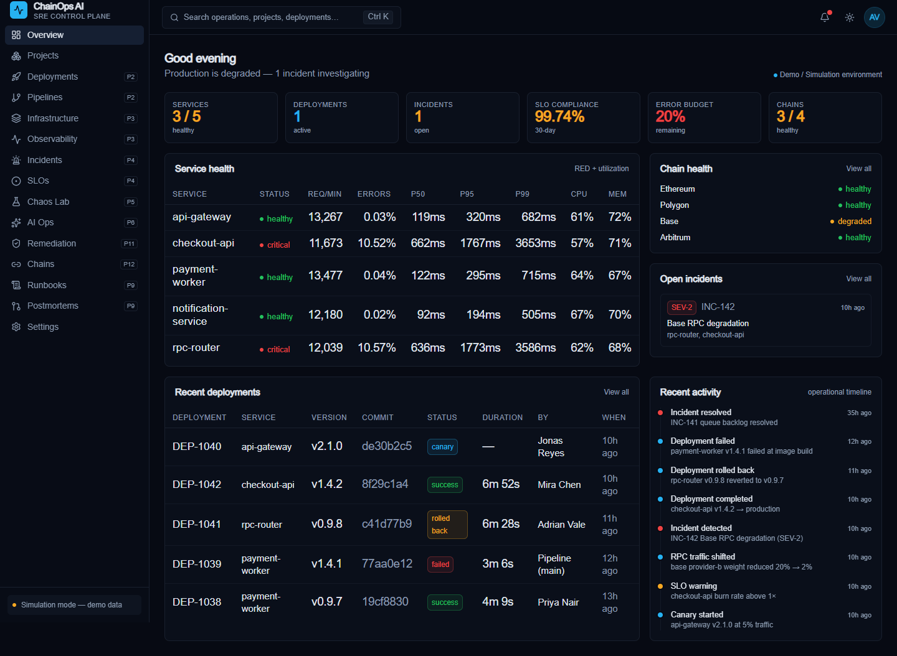
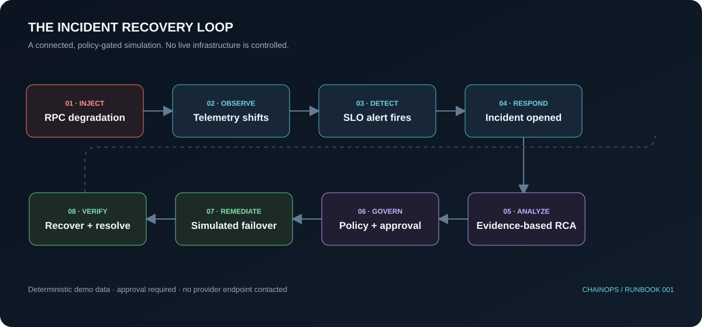
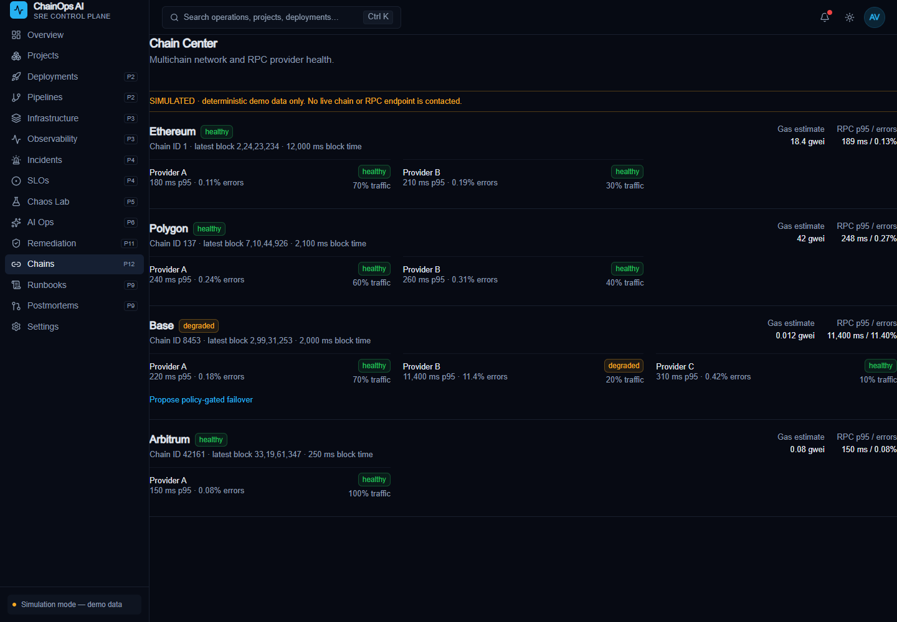
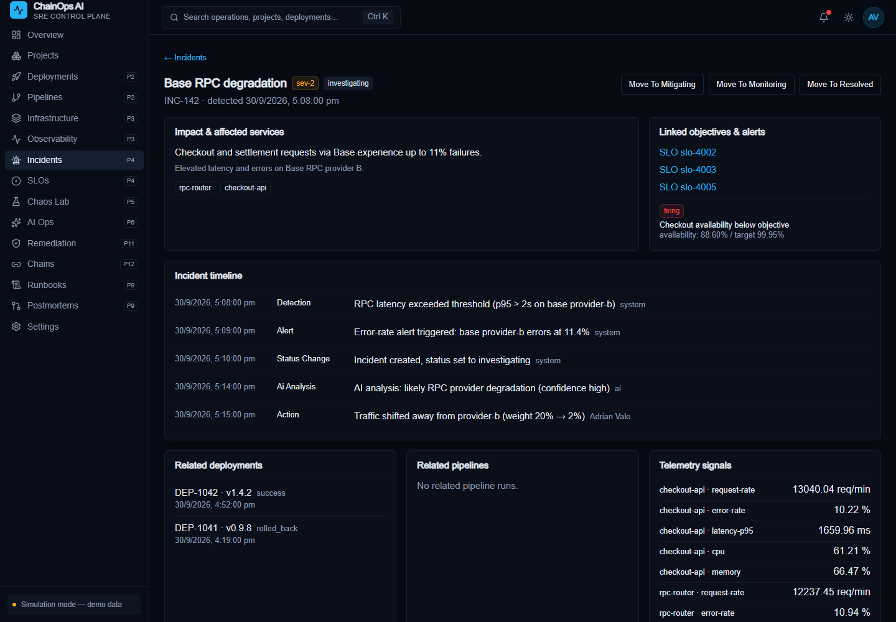

<div align="center">

# ChainOps AI

### See the failure. Understand the blast radius. Recover with control.

An operator-focused SRE control plane demo connecting service health, chain RPCs, SLOs,
incidents, evidence-based analysis, and approval-gated recovery.

[Watch the walkthrough](assets/readme/chainops-walkthrough.webm) · [Open the animated recovery loop](assets/readme/operational-loop.svg)

</div>

> **Demo environment only.** Services, chains, providers, telemetry, deployments, and recovery
> actions are simulated and stored in memory. This project does not contact RPC endpoints,
> Kubernetes, GitHub, telemetry collectors, or external AI models. It is not production-ready.



## The operating loop



RPC degradation is reflected in dependent-service telemetry and SLO evaluation. The resulting
evidence informs incident analysis. A failover must be proposed, policy-checked, and approved
before the simulator redistributes traffic and verifies recovery.

## Product tour

| Chain Center | Incident evidence |
| --- | --- |
|  |  |

The [short WebM walkthrough](assets/readme/chainops-walkthrough.webm) cycles through the real
local dashboard, chain health, and incident screens. These captures show seeded demo state; they
are not live infrastructure or a recording of a real outage.

## What is here

**Status: local-first demonstration, not a production control plane.** Several workflows are
implemented end to end against deterministic in-memory simulations. No real infrastructure is
controlled. Review the limitations below before deploying or connecting real systems.

- **Operational overview:** service health, SLO compliance, chain status, deployments, incidents,
  and recent activity.
- **Projects and analysis:** project management and deterministic repository metadata analysis.
- **Delivery:** staged deployment and CI simulations with progress, logs, canary weights, retry,
  cancellation, and rollback flows.
- **Observability and SLOs:** five-minute simulated metric samples, correlated logs/traces,
  service-level indicators, error budgets, and deployment policy checks.
- **Incident response:** alert-to-incident correlation, guarded lifecycle transitions, evidence
  bundles, and postmortem drafts.
- **Chaos Lab:** bounded, allowlisted simulated failures with confirmation and telemetry effects.
- **Chain Center:** simulated Ethereum, Polygon, Base, and Arbitrum health, block progression,
  gas estimates, RPC latency/error rates, and weighted providers.
- **Policy and remediation:** audited, allowlisted proposals requiring approval before simulated
  RPC failover or other supported recovery actions.

## Try the recovery story

1. Start the app and open **Chains**. Base is seeded with a degraded RPC provider.
2. Follow **Propose policy-gated failover** to create a remediation proposal.
3. Approve and execute the proposal in **Remediation**. The simulator shifts traffic to healthy
   peers and clears the injected provider failure.
4. Check **Observability**, **SLOs**, and **Incidents** for the resulting recovery state.

The UI uses seeded demo principals because authentication is not implemented. Role checks are
demo workflow controls, not a security boundary.

## Run locally

**Requirements:** Node.js 22 and npm.

```bash
npm ci
npm run dev
```

Open [http://localhost:3000](http://localhost:3000). The in-memory demo dataset is restored on
server startup and can be reset from Settings. Changes made during a session do not persist
across a server restart.

## Verify

```bash
npm test
npx tsc --noEmit
npm run lint
npm run build
```

The test suite covers domain state machines, validation, service behavior, simulated providers,
telemetry/SLO/incident integration, remediation policy, and the multichain recovery workflow.
There are no browser-driven end-to-end tests yet.

## Architecture

```text
App Router UI
    │
    ▼
Validated API routes ─────── Server-rendered service reads
    │                                      │
    ▼                                      ▼
Application services ─────── Composition root (container.ts)
    │
    ▼
Domain + ports
    │
    ├── deterministic simulation engine
    └── in-memory repositories + simulated adapters
```

Services depend on provider ports, not UI components. `src/server/container.ts` wires the
simulated adapters; replacing them with real integrations would still require production-grade
identity, persistence, secrets/configuration, policy enforcement, observability, and deployment
hardening.

## Honest limitations

- No authentication or production authorization.
- No durable database; server restart resets state.
- No live blockchain/RPC, Kubernetes, GitHub, CI, telemetry, or AI-provider connections.
- Gas prices, chain/provider health, and generated analysis are deterministic demo values.
- No production deployment configuration or browser E2E coverage.

See [Architecture](docs/ARCHITECTURE.md), [Development](docs/DEVELOPMENT.md), and
[Roadmap](docs/ROADMAP.md) for implementation status and engineering details.

## Contributing and license

Run the checks in [Development](docs/DEVELOPMENT.md) before opening a change. GitHub Actions runs
tests, type checking, lint, and a production build on pushes and pull requests. No license is
included yet; the repository owner must choose one before granting reuse rights.
